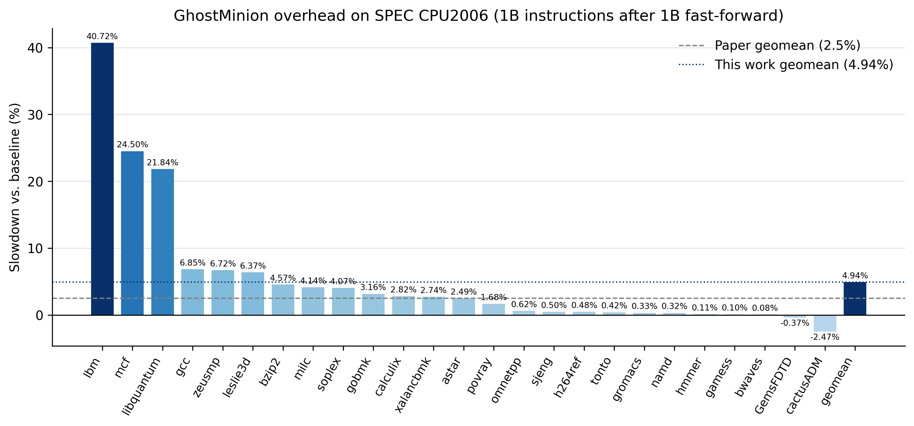
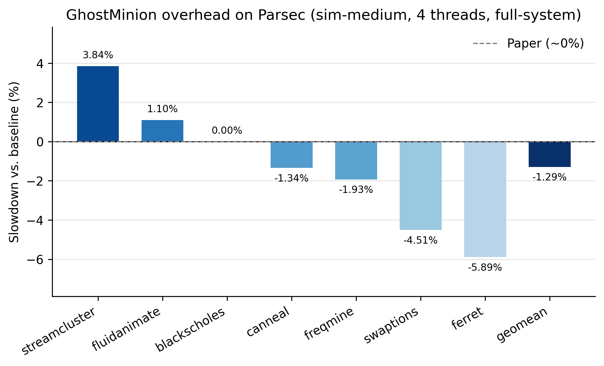
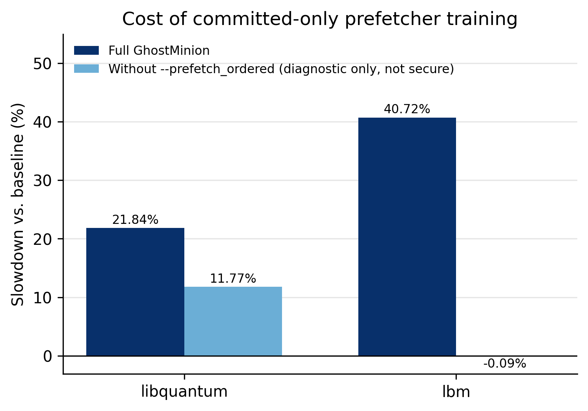
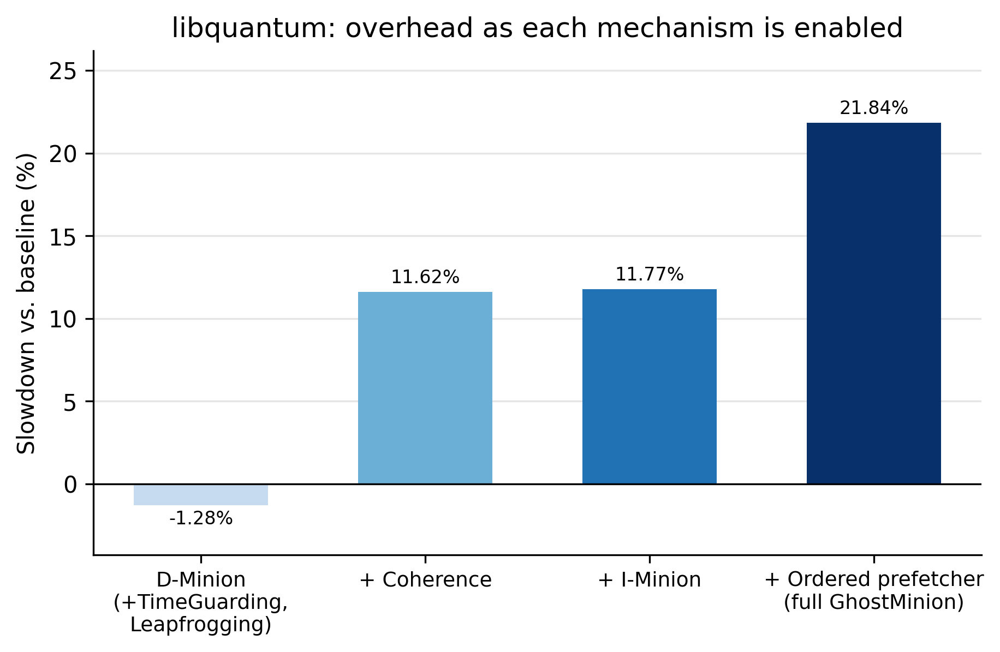

# Reproducing GhostMinion on gem5

A reproduction of the SPEC CPU2006 and Parsec results of

> S. Ainsworth, *GhostMinion: A Strictness-Ordered Cache System for Spectre Mitigation*,
> MICRO 2021. [arXiv:2104.05532](https://arxiv.org/abs/2104.05532),
> DOI [10.1145/3466752.3480074](https://doi.org/10.1145/3466752.3480074)

using the author's artefact ([SamAinsworth/reproduce-ghostminion-paper](https://github.com/SamAinsworth/reproduce-ghostminion-paper), tag `AEV3`, modified gem5 v20.1) on a shared university cluster without root access, Docker or a system compiler.

Lamprini Nikitaki, School of Electrical and Computer Engineering, National Technical University of Athens (NTUA).
Semester project for the course *Advanced Topics in Computer Architecture*, 2026–2027.

This repository contains everything I wrote or changed on top of the artefact: the environment, three small patches, the run and collection scripts, the analysis script, the final results and figures, and the presentation slides. It does not contain gem5, the artefact itself, SPEC, or any benchmark inputs (see [What is not included](#what-is-not-included)).

The slides of the intermediate and final presentations are in [`docs/`](docs/): [intermediate slides](docs/slides_intermediate.pdf), [final slides](docs/slides_final.pdf).

## Contents

- [Background](#background)
- [What was reproduced](#what-was-reproduced)
- [Results](#results)
- [Comparison with the paper](#comparison-with-the-paper)
- [Observation: the ordered prefetcher on lbm and libquantum](#observation-the-ordered-prefetcher-on-lbm-and-libquantum)
- [Reproducing the results](#reproducing-the-results)
- [Repository layout](#repository-layout)
- [What is not included](#what-is-not-included)
- [License and citation](#license-and-citation)

## Background

Spectre-style attacks use transient (later squashed) instructions to leave a trace in microarchitectural state, typically the caches, and then recover a secret through a timing side channel. Defences such as InvisiSpec and MuonTrap hide speculative cache fills until the load is known to be safe, but they still allow a transient instruction to affect the timing of an *older* instruction, which is enough to leak information.

The paper introduces **Strictness Ordering**: an event *x* may influence the timing of an event *y* only if the commit of *y* implies the commit of *x*. In a single thread this means that speculative state may only flow forwards in program order, never backwards. GhostMinion enforces a slightly stronger version of this rule (Temporal Order) in the cache hierarchy:

- **GhostMinions (D-Minion and I-Minion).** Small caches (2 KiB, 2-way) next to the L1D and L1I, accessed in parallel with them. Speculative fills go only into the GhostMinion. On commit, the line is moved to the L1; on a squash, the entries younger than the squash point are invalidated in a single cycle. The rest of the hierarchy never sees speculative data.
- **TimeGuarding.** Each instruction carries a timestamp. A speculative access may only hit on a GhostMinion line brought in by an older or equally old instruction, and a fill may only evict a line with a younger timestamp.
- **Leapfrogging.** When the MSHRs are full, an older instruction may take an MSHR from a younger one. This prevents a transient load from delaying an older one through resource contention.
- **Coherence.** GhostMinion lines can only be Shared or Invalid. A speculative load that would require a remote Exclusive or Modified copy to change state either waits until it is non-speculative or is replayed at commit.
- **Ordered prefetching.** Prefetchers in the non-speculative levels are trained only on committed accesses (`--prefetch_ordered` in the artefact).

The paper reports a geometric-mean slowdown of 2.5% on SPEC CPU2006 (worst case mcf, almost 30%), 0.6% on SPECspeed 2017 and no measurable overhead on Parsec. The simulated system is a 4-core, 8-wide out-of-order AArch64 core at 2 GHz with a 64 KiB L1D, 32 KiB L1I and a shared 2 MiB L2 with a stride prefetcher (Table 1 of the paper).

## What was reproduced

| Suite | Mode | Configuration | Status |
|---|---|---|---|
| SPEC CPU2006, 25 benchmarks | syscall emulation | 1B instructions fast-forward, then 1B detailed (DerivO3CPU) | reproduced |
| SPEC CPU2006, lbm and libquantum | syscall emulation | ablation: GhostMinion mechanisms enabled one at a time | extra |
| Parsec, 7 benchmarks | full system | sim-medium, 4 cores / 4 threads, ROI only | reproduced |
| SPECspeed 2017 | syscall emulation | | not run (time) |

All runs use the artefact's default GhostMinion parameters (2 KiB, 2-way). Baseline and GhostMinion runs for a benchmark were done on the same machine with the same binaries and inputs. Overhead is defined as

```
overhead = sim_seconds(GhostMinion) / sim_seconds(baseline) - 1
```

and geometric means are taken over the time ratios, computed from the raw `sim_seconds` values in [`results/`](results/), not from the rounded percentages.

## Results

### SPEC CPU2006



| | This work | Paper |
|---|---|---|
| Geometric mean, 25 benchmarks | **4.94%** | 2.5% |
| Geometric mean without lbm and libquantum | 2.94% | |
| Worst case | lbm 40.72% | mcf, almost 30% |
| mcf | 24.50% | almost 30% |
| Benchmarks below 5% / below 1% | 19 / 11 | |

Most benchmarks behave as in the paper: a long tail of near-zero overheads and a few memory-intensive workloads that lose the benefit of misspeculated accesses, which in the baseline act as useful prefetches (mcf, gcc, zeusmp, leslie3d, bzip2; the paper names the same group in Sec. 6.1–6.2). The difference in the geometric mean comes almost entirely from two benchmarks, lbm and libquantum, which are discussed [below](#observation-the-ordered-prefetcher-on-lbm-and-libquantum). Without them the geometric mean is 2.94%, close to the paper's 2.5%.

Every configuration of a given benchmark simulated the same instruction stream: `sim_insts` differs by at most 6 instructions out of about 2·10⁹ between baseline, GhostMinion and the ablation runs. `sim_seconds` covers only the detailed part of each run, because gem5 resets the statistics when it switches from the fast-forward CPU to the out-of-order CPU; for example, libquantum without the ordered prefetcher switches at 0.501 s and exits at 1.163 s, and its `sim_seconds` is 0.662 s.

Per-benchmark numbers: [`results/spec06_results.csv`](results/spec06_results.csv) (overheads, 3 decimals) and [`results/spec06_raw.csv`](results/spec06_raw.csv) (`sim_seconds` and `sim_insts` for every run).

### Parsec



| Benchmark | Baseline ROI (s) | GhostMinion ROI (s) | Overhead |
|---|---|---|---|
| blackscholes | 0.081755 | 0.081759 | 0.00% |
| canneal | 0.464351 | 0.458128 | −1.34% |
| ferret | 0.385370 | 0.362679 | −5.89% |
| fluidanimate | 0.254603 | 0.257401 | 1.10% |
| freqmine | 1.466032 | 1.437769 | −1.93% |
| streamcluster | 0.727460 | 0.755415 | 3.84% |
| swaptions | 0.512433 | 0.489330 | −4.51% |
| **Geometric mean** | | | **−1.29%** |

The paper reports no overhead on Parsec, and the geometric mean here is in the same range. The individual benchmarks spread more widely, with three of them running noticeably faster under GhostMinion. I checked the following before accepting these numbers:

- after restoring from the checkpoint, both runs switch to the out-of-order CPU (the `system.switch_cpus0.iq.*` stats are present);
- `sim_insts` is almost identical between baseline and GhostMinion (difference below 0.25%);
- each stats file has two dumps: the ROI (used here) and a cumulative one up to exit, which gives practically the same overheads (ferret −5.44%, swaptions −4.46%, freqmine −1.88%);
- the GhostMinion run's `config.ini` has `ghostSize=2048`, `ghostAssoc=2`;
- re-running a simulation gives exactly the same time.

The obvious explanation, fewer conflict misses in the L1D, does not hold: L1D misses on core 0 *increase* with GhostMinion (ferret +33%, freqmine +27%, canneal +6%, roughly unchanged for swaptions and streamcluster). A more likely cause is a change in thread interleaving and synchronisation timing, which in a 4-thread full-system run can move the ROI time by a few percent in either direction. I have not verified this further.

## Comparison with the paper

| Point | Paper | This work | Agreement |
|---|---|---|---|
| SPEC CPU2006 geometric mean | 2.5% | 4.94% (2.94% without lbm, libquantum) | partial |
| mcf is among the worst cases | almost 30% | 24.50% | yes |
| Most workloads below a few percent | yes | 19 of 25 below 5% | yes |
| D-Minion alone speeds up libquantum (fewer conflict misses) | yes (Sec. 6.2) | −1.28% | yes |
| Instruction-side GhostMinion costs nothing | yes (Sec. 6.2) | +0.15 pp on libquantum | yes |
| Ordered prefetcher is a minor cost and helps lbm | yes (Sec. 6.2) | 40.7 pp of lbm's overhead, 10.1 pp of libquantum's | **no** |
| Parsec | 0% | −1.29% | yes, within noise of a multi-threaded run |
| SPECspeed 2017 | 0.6% | not run | |

## Observation: the ordered prefetcher on lbm and libquantum

> This section describes a measured difference and a possible explanation. The explanation is a hypothesis and has not been confirmed.

To find out why lbm and libquantum are so far from the paper, I re-ran them with parts of GhostMinion switched off. Turning off only the ordered prefetcher is **not a secure configuration**; it is used purely as a diagnostic.

| Configuration | gem5 options | Script | lbm | libquantum |
|---|---|---|---|---|
| D-Minion only (with TimeGuarding, Leapfrogging) | `--ghostminion` | `run_libq_breakdown.sh` | | −1.28% |
| + coherence | `--ghostminion --cache_coher` | `run_libq_breakdown.sh` | | 11.62% |
| + I-Minion (everything except the ordered prefetcher) | `--ghostminion --cache_coher --ghost_size=2kB --iminion` | `run_nopf.sh` | −0.09% | 11.77% |
| + ordered prefetcher (full GhostMinion) | `--ghostminion --cache_coher --ghost_size=2kB --iminion --prefetch_ordered` | artefact's `run_spec06.sh` | 40.72% | 21.84% |

All runs share the same base options as the artefact (`--caches --l2cache --cpu-type=DerivO3CPU --fast-forward=1000000000 --maxinsts=1000000000 --mem-size=4096MB`); the two runs without `--ghost_size` use the default, which is also 2 kB. The third row is a single set of runs (`m5out_nopf`). For libquantum it is both the "+ I-Minion" step of the incremental breakdown and the "without ordered prefetcher" bar in the figure below; for lbm it is the only ablation run.




On **lbm** the ordered prefetcher accounts for the whole overhead: without it, GhostMinion is free. On **libquantum** it accounts for about 10 of the 22 percentage points, and most of the remainder comes from the coherence protection. In the paper the situation is reversed for lbm: the prefetcher is a secondary cost overall, and on lbm it *helps*, because training only on committed accesses presents a more regular stream.

The gem5 stats point to prefetch timeliness rather than prefetch count or MSHR pressure:

| | lbm | libquantum |
|---|---|---|
| Change in number of prefetches issued | −2% | −24% |
| Miss rate, baseline → GhostMinion | L2: 5.7% → 12.2% | L1: 57.6% → 71.2% |
| Cycles blocked on MSHRs | +32% | +27% |
| Runtime | +41% | +22% |

On lbm the prefetcher issues almost the same number of prefetches, yet the L2 miss rate doubles, which suggests that the prefetches arrive too late once training is delayed until commit. The cycles blocked on full MSHRs grow roughly in proportion to runtime, so MSHR contention does not look like the cause.

**Hypothesis.** The access pattern seen by the prefetcher depends on the generated code. These binaries were built with aarch64 GCC 9.5 from conda-forge, while the artefact's configuration uses Ubuntu's GCC 5 cross-compilers (`aarch64-linux-gnu-gcc-5`, installed by its `scripts/dependencies.sh`). A different loop structure or unrolling in lbm's and libquantum's hot loops could change how far ahead of commit the useful accesses are, and therefore how much is lost by training only on committed accesses. Testing this would need rebuilding both benchmarks with the original toolchain and repeating the ablation, which I have not done.

## Reproducing the results

The full, step-by-step environment guide (micromamba environments, every workaround, and the error messages they fix) is in [`docs/setup_cslab.md`](docs/setup_cslab.md). The outline below is enough if you are comfortable with gem5.

### Requirements

- An x86-64 Linux machine with many cores. The runs here used a node with 2 × 14 cores (56 threads) and 188 GB of RAM; all 25 SPEC benchmarks ran in parallel, one per physical core.
- No root access is needed. Everything is installed under a user directory with [micromamba](https://mamba.readthedocs.io/).
- A licensed copy of SPEC CPU2006 (v1.1 was used here). It is not distributed with this repository.
- For Parsec, the artefact's prebuilt disk image `aarch64-ubuntu-trusty-headless.img.tar.gz` from its Releases page.

Two kinds of scripts are used below. The artefact's own scripts (`build.sh`, `run_spec06.sh`, `build_parsec_simplified.sh`, `run_parsec.sh`) are run from `$ARTEFACT/scripts`, because they locate everything relative to that directory. The scripts in this repository (`scripts/`) can be run from anywhere once `env/env.sh` has been sourced.

### 1. Environments

```bash
git clone https://github.com/lampriniNik/GhostMinion.git
cd GhostMinion

# micromamba is a single binary; install it somewhere under your own directory
export MAMBA_ROOT_PREFIX=/local/$USER/mamba
micromamba create -n gem5       -f env/environment-gem5.yml
micromamba create -n spec-cross -f env/environment-spec-cross.yml

source env/env.sh
```

- `gem5`: Python 3.8, SCons 3.1.2, GCC/G++ 7.5, libxcrypt, a glibc 2.17 sysroot, dtc.
- `spec-cross`: aarch64 GCC/G++/GFortran 9.5 with a glibc 2.17 sysroot, used to cross-compile SPEC.

`env/env.sh` activates `gem5` and sets `CC`, `CXX`, `CPATH`, `LIBRARY_PATH` and `LD_LIBRARY_PATH`. Its default paths (`/local/$USER/...`) are those of the CSLab node; set `MAMBA_ROOT_PREFIX`, `MICROMAMBA` and `ARTEFACT` before sourcing it to use other locations.

### 2. Get the artefact and apply the patches

```bash
scripts/bootstrap.sh /local/$USER
```

This clones the artefact, checks out tag `AEV3` (commit `38b24e0`), verifies the commit, and applies the three patches in [`patches/`](patches/):

| Patch | File in the artefact | Change |
|---|---|---|
| `0001-gem5-scons-pass-CPATH` | `gem5/site_scons/site_tools/default.py` | SCons passes `CPATH` to the compiler, so that `crypt.h` from the environment is found. The only change to gem5. |
| `0002-run_spec06-run-25-benchmarks-in-parallel` | `scripts/run_spec06.sh` | `P=25` instead of `min(cores, RAM / 2 GiB)`. |
| `0003-spec-aarch64-cfg-conda-cross-compilers` | `spec_confs/aarch64.cfg` | conda-forge AArch64 GCC 9.5 instead of Ubuntu's GCC 5; `-std=gnu++98` for soplex and `-std=legacy` for gamess. |

GhostMinion's code is not modified.

### 3. Build gem5

```bash
cd $ARTEFACT/scripts && ./build.sh
```

### 4. Build SPEC CPU2006

The artefact's `build_spec06.sh` mounts the SPEC ISO with `sudo`. Without root, copy an installed SPEC CPU2006 tree to `$ARTEFACT/SPEC` and run

```bash
scripts/build_spec06_noroot.sh
```

It fixes the paths of the moved installation (`bin/relocate`), installs the patched config, runs the artefact's `runspec` commands, renames run directories to the `.0000` suffix the run scripts expect, and prints the checksums of astar's `BigLakes2048.cfg` for comparison with SPEC's `MANIFEST` (the file was corrupted in the installation used here). The `runspec --action=run` step reports failures because the AArch64 binaries cannot run on the x86 host; that is expected.

### 5. Run

```bash
cd $ARTEFACT/scripts
./run_spec06.sh                 # 25 benchmarks, baseline + full GhostMinion

cd -
scripts/run_nopf.sh             # lbm, libquantum: without --prefetch_ordered
scripts/run_libq_breakdown.sh   # libquantum: D-Minion only, D-Minion + coherence

cd $ARTEFACT/scripts            # Parsec: disk image in aarch_system/disks/ first
./build_parsec_simplified.sh
./run_parsec.sh                 # 7 benchmarks, baseline + full GhostMinion
```

<!-- TODO: wall-clock time of the SPEC and Parsec runs -->

### 6. Collect results and plot

```bash
scripts/collect_parsec.sh       # writes $ARTEFACT/run_parsec/parsec_results.csv
python3 analysis/plot_ghostminion.py $ARTEFACT/SPEC/benchspec/CPU2006 \
        --out figures --parsec-csv $ARTEFACT/run_parsec/parsec_results.csv
```

`plot_ghostminion.py` reads the gem5 `stats.txt` files directly, prints the summary numbers above, and writes the three CSV files in `results/` and the four figures in `figures/` (PNG and PDF). It needs only Python 3 and matplotlib.

## Repository layout

```
GhostMinion/
├── README.md
├── LICENSE
├── docs/
│   ├── setup_cslab.md                detailed setup guide (no root, micromamba)
│   ├── slides_intermediate.pdf       intermediate presentation
│   └── slides_final.pdf              final presentation
├── env/
│   ├── env.sh                        source before building or running
│   ├── environment-gem5.yml
│   └── environment-spec-cross.yml
├── patches/                          applied to the artefact by bootstrap.sh
│   ├── 0001-gem5-scons-pass-CPATH.patch
│   ├── 0002-run_spec06-run-25-benchmarks-in-parallel.patch
│   └── 0003-spec-aarch64-cfg-conda-cross-compilers.patch
├── scripts/
│   ├── bootstrap.sh                  clone the artefact at AEV3, apply patches
│   ├── build_spec06_noroot.sh        build SPEC CPU2006 without sudo
│   ├── run_nopf.sh                   ablation: without the ordered prefetcher
│   ├── run_libq_breakdown.sh         ablation: libquantum, mechanism by mechanism
│   └── collect_parsec.sh             Parsec ROI times -> CSV
├── analysis/
│   └── plot_ghostminion.py           CSV files and figures from gem5 stats
├── results/
│   ├── spec06_raw.csv                sim_seconds, sim_insts per benchmark and configuration
│   ├── spec06_results.csv            overhead per benchmark and configuration
│   └── parsec_results.csv            ROI times and overhead
└── figures/                          fig1–fig4, PNG and PDF
```

## What is not included

- **SPEC CPU2006.** SPEC is licensed software; no sources, binaries, inputs or run directories are included. Only my configuration file and scripts are.
- **gem5 and the artefact.** They are fetched from upstream by `scripts/bootstrap.sh`; only my changes are kept here, as patches.
- **Parsec inputs, disk images and kernels.** Too large, and available from the artefact.
- **Raw gem5 output.** The full `stats.txt` files are large. The values used in the analysis are in `results/`.

## License and citation

The scripts, analysis code and documentation in this repository are released under the [MIT License](LICENSE). gem5, the GhostMinion artefact and SPEC CPU2006 are covered by their own licenses; the patches in `patches/` modify gem5 files and remain under gem5's license.

If you use these results, please cite the original paper:

```bibtex
@inproceedings{ainsworth2021ghostminion,
  author    = {Ainsworth, Sam},
  title     = {GhostMinion: A Strictness-Ordered Cache System for Spectre Mitigation},
  booktitle = {Proceedings of the 54th Annual IEEE/ACM International Symposium on Microarchitecture (MICRO)},
  year      = {2021},
  doi       = {10.1145/3466752.3480074}
}
```

The simulations were run on the computing infrastructure of the Computing Systems Laboratory (CSLab), NTUA.
